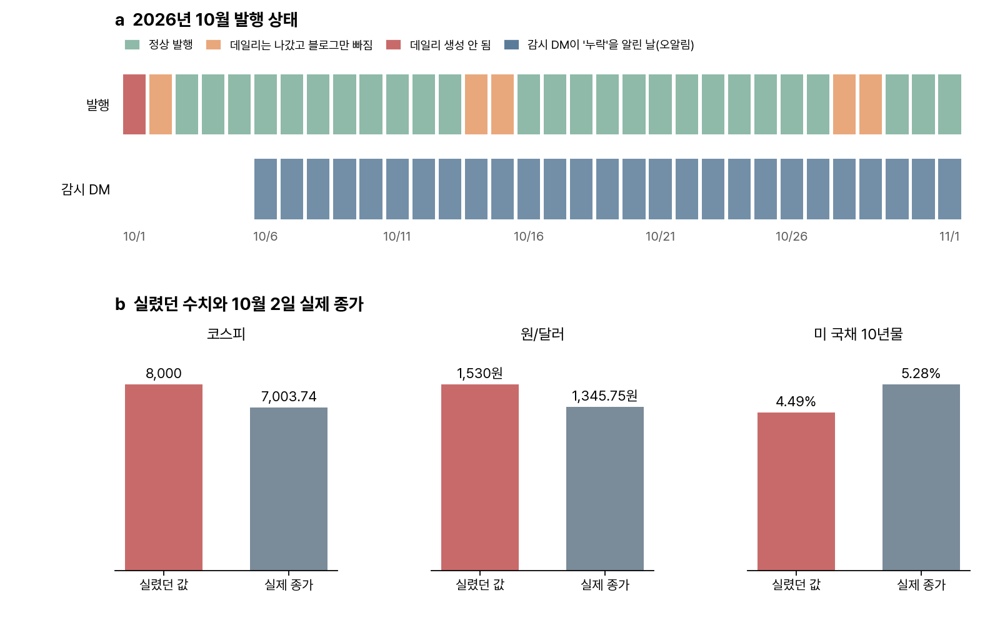



안녕하세요. 임상 데이터, 유전체학, 머신러닝을 넘나들며 일하는 바이오인포매틱스 연구자 김가경입니다.

6월부터 매일 자동으로 발행해 온 경제 뉴스레터 econ-radar를 5개월 만에 점검해 보니, 10월 한 달 동안 블로그 페이지 5개가 빠졌는데 배포 스크립트는 매번 "공개 완료"를 출력했습니다. 7월 기사의 코스피 8,000이 10월 3일 호에 실린 것(10월 2일 실제 종가 7,003.74)도 찾았고 이런 수치를 실제 시세와 기계적으로 대조하는 검사를 붙였습니다.

econ-radar는 Claude Code 클라우드 루틴으로 돌아가는 뉴스레터입니다. 수집, 분석, 편집, 문체 검수, 사실 검증, 렌더링을 맡은 에이전트들이 매일 저녁 한 호를 만들고 블로그와 텔레그램과 메일로 내보냅니다. [6월에 구조를 소개했고](/kr/2026/06/10/econ-radar-agent-harness/), [자동 발행으로 넘어간 과정](/kr/2026/06/12/econ-radar-auto-publish/)과 [20일간의 변화](/kr/2026/07/01/econ-radar-20-day-evolution/)도 적었습니다. 그 뒤로는 잘 돌아간다고 생각하고 거의 들여다보지 않았습니다.

점검은 2026년 11월 2일에 했습니다. 클라우드 루틴의 실행 기록, GitHub Actions 실행 로그, 블로그 저장소 커밋 기록을 대조했고 시세는 [FRED](https://fred.stlouisfed.org/series/DGS10)의 미 국채 10년물과 원/달러 환율, Yahoo Finance의 코스피 일별 종가를 기준으로 삼았습니다.

## econ-radar 운영 현황

| 항목 | 값 |
|---|---|
| 발행 기간 | 2026-06-09 ~ 2026-11-01 |
| 데일리 | 143편 (생성되지 않은 날 4일, 그중 하루는 소급 발행) |
| 주간 동향 리포트 | 22편 (W24 ~ W44) |
| 구독 | 메일 18명, 텔레그램 13명 |

구독자가 많지 않은 상태로 다섯 달을 왔습니다. 텔레그램 글 조회는 글마다 한두 번이었고 메일 열람 수는 0으로 나왔는데 원인을 보니 Buttondown이 새 계정의 [열람 추적을 기본으로 꺼 둔 것](https://buttondown.com/blog/opt-in-analytics)이었습니다. 독자가 얼마나 읽는지는 지금부터 재기 시작합니다.



## 발행 감시의 오알림

10월 초에 데일리가 하루 통째로 빠진 일이 있었습니다. 클라우드 루틴이 사용량 한도에 걸려 1초 만에 끝났는데도 기록에는 성공으로 남았습니다. 그래서 매일 밤 10시에 데일리 파일과 블로그 페이지가 있는지 확인하고 없으면 개인 텔레그램으로 알리는 감시 워크플로를 붙였습니다.

그 감시가 10월 6일부터 매일 "누락" 알림을 보냈습니다. 열어 보면 페이지는 멀쩡히 있었습니다. GitHub Actions 실행 기록을 보니 밤 10시로 예약한 실행이 실제로는 다음 날 새벽 2시에서 6시 40분 사이에 시작됐습니다. 감시는 실행된 시각의 날짜를 확인했으니, 아직 만들어지지 않은 다음 날 데일리를 찾고 있었던 것입니다.

오알림은 진짜 누락까지 가렸습니다. 10월 14일, 15일, 28일, 29일에는 실제로 블로그 페이지가 빠졌는데, 감시는 엉뚱한 날짜를 보고 있어 이 넷을 잡지 못했습니다. 지금은 실행 시각에서 12시간을 뺀 날짜를 확인하게 고쳤고 실제 오알림이 났던 시각을 흉내 내 GitHub에서 다시 돌려 확인했습니다.

## 블로그 배포의 거짓 성공

블로그 페이지가 빠진 날의 클라우드 실행 기록을 열어 보니, 배포 스크립트의 마지막 출력이 이랬습니다.

```
✅ 커밋 완료
Everything up-to-date
🚀 공개 완료 (1~2분 뒤 라이브)
```

클라우드 세션은 저장소를 브랜치가 아닌 특정 커밋에 고정된 상태(detached HEAD)로 받습니다. 이 상태에서 스크립트가 새 페이지를 커밋하고 `git push origin main`을 하면, 새 커밋이 아니라 예전 main이 그대로 올라가 "Everything up-to-date"가 나옵니다. 스크립트는 오류 없이 끝났고 "공개 완료"를 출력했으며 세션은 그 출력을 믿고 라이브 주소까지 붙여 발행 완료를 보고했습니다. 같은 스크립트를 쓰는 주간 논문 다이제스트 paper-radar도 4주치가 같은 이유로 빠져 있었습니다.

고친 방법은 두 가지입니다. 지금 위치의 커밋을 밀도록 `git push origin HEAD:main`으로 바꿨고 push 뒤에 원격 저장소에 그 날짜 페이지가 실제로 들어갔는지 확인해서 없으면 실패로 끝내게 했습니다. 고치기 전 스크립트로 detached HEAD 상황을 재현해 거짓 성공이 나오는 것을 먼저 확인했고 고친 스크립트로 빠진 paper-radar 4주를 실제로 올리면서 한 번 더 확인했습니다.

## 7월 기사 수치의 재사용

10월 3일 호의 투자 항목은 "코스피 8,000선, 원/달러 1,530~1,560원대"였습니다. 근거로 단 링크는 7월 3일자 기사였습니다. 10월 2일 실제 종가는 코스피 7,003.74, 원/달러 1,345.75원이었습니다. 10월 4일 호에는 "미 국채 10년물이 고용 쇼크 이후 4.49%로 내려왔다"는 항목이 있었는데, 그날 10년물은 5.28%로 오히려 올랐습니다. 10월 9일 호의 "10년물 5.35% 돌파"는 장중 고점을 종가처럼 쓴 것이었습니다(종가 기준 고점은 10월 5일의 5.31%).

사실 검증 에이전트가 있는데도 이런 수치가 나간 이유는 실행 기록에 있었습니다. 클라우드 세션은 허용된 도메인 밖으로 접속할 수 없어서 사실 검증 단계가 원문 기사를 거의 열지 못했습니다. 한 날은 지정된 출처 도메인 아홉 곳이 모두 접속 실패였는데도 결과는 "수치 10개 대조, 오류 0건"이었습니다. 원문을 열지 못한 상태의 "오류 0건"은 확인했다는 뜻이 되지 못합니다.

## 시장 수치 대조 검사

그래서 수치 확인을 원문 접속에 기대지 않는 검사로 따로 만들었습니다. 데일리 본문에서 코스피, 미 국채 10년물, 원/달러 값을 뽑아 직전 30일 실제 종가 범위와 비교하고 시장 수준을 다루는 항목에 3주 넘게 지난 기사 링크가 붙어 있으면 표시합니다. 증권사의 목표 지수나 다른 나라 국채, 출처 목록에 적힌 기사 제목처럼 비교하면 안 되는 문장은 뺍니다.

| 확인 | 결과 |
|---|---|
| 고치기 전 10월 3일, 4일 호 | 코스피 8,000, 원/달러 1,530원, 10년물 4.49%를 모두 표시 |
| 고친 뒤 같은 호 | 표시 0건 |
| 9~11월 호 전체 | 낡은 근거 링크 2건(실제 문제) |

이 검사는 클라우드 루틴 안에서 한 번 돌고 데일리가 저장소에 올라오면 GitHub Actions에서 실제 시세를 받아 한 번 더 돕니다. 걸리는 것이 있으면 개인 텔레그램으로 알립니다. 클라우드 세션이 열지 못하는 시세 사이트도 GitHub의 실행 환경에서는 열립니다. 텔레그램 발송을 클라우드에서 GitHub Actions로 옮겼을 때와 같은 방식입니다.

## 검색 노출 정비

점검하면서 데일리 페이지의 제목이 날짜뿐이라는 것도 보였습니다("econ-radar — 2026-11-01"). 검색 결과에 보일 요약, 링크를 공유할 때의 미리보기, 검색엔진과 AI가 읽는 구조화 데이터도 없었습니다. 블로그 글에는 [지난달에 다 넣어 둔 것](/kr/2026/10/23/agent-cleanup-review-gate/)들입니다.

- 제목을 그날 화제가 들어간 문장으로 바꿨습니다("DNA 치료백신의 첫 FDA 허가 \| econ-radar 2026-11-01").
- 요약, 미리보기, 구조화 데이터(NewsArticle)를 새 페이지와 기존 페이지 161개에 넣었습니다.
- 데일리 하단에 텔레그램 옆으로 메일 구독 버튼을 달았습니다.
- 띄어쓰기와 하이픈 차이로 갈라져 있던 주제 노트 13묶음(ADC 5개, GLP-1 6개 등)을 하나로 합쳤습니다. 다음에 만들 주제별 페이지의 바탕입니다.

효과는 아직 재지 않았습니다. 방문 분석을 오늘 붙였으니 몇 주 뒤에 비교해 보려고 합니다.

## 배운 것

- **성공 메시지는 결과가 아닙니다.** 10월 28일과 29일 이틀 동안 스크립트의 "공개 완료"와 세션의 "발행 완료"가 같은 거짓 보고를 했습니다. 원격 저장소에 파일이 실제로 있는지, 페이지가 실제로 열리는지를 확인하는 단계가 따로 있어야 합니다.
- **감시도 틀립니다.** 매일 오는 오알림은 무시하게 되고 그 사이에 진짜 누락이 묻혔습니다. 감시를 만들 때는 감시가 무엇을 보고 있는지 한 번은 직접 확인해야 합니다.
- **검증 에이전트가 원문을 열 수 있는지부터 확인해야 합니다.** 열지 못하면 대조할 수 없고 대조하지 못한 것을 "오류 없음"으로 세면 안 됩니다. 시세처럼 기계로 받을 수 있는 값은 접속이 열린 곳에서 기계로 대조하는 편이 낫습니다.

## 구독 안내

econ-radar는 제약, 바이오, AI 비중이 큰 한국어 경제 뉴스레터입니다. 국내외 신뢰할 만한 경제지를 바탕으로 매일 핵심 5건을 산업구조, 투자, 시장(떠오르는 기업과 수요) 세 관점으로 정리하고 해외 기사는 한국어로 옮깁니다. 매수나 매도를 권하지 않고 판단에 쓸 정보와 시나리오만 드립니다.

- **메일:** [buttondown.com/kakyungkim](https://buttondown.com/kakyungkim). 매일 저녁 6시 반 이후, 주간 동향은 월요일 아침
- **텔레그램:** [t.me/econradar](https://t.me/econradar)
- **지난 호 전체:** [kakyungkim.github.io/econ-radar](https://kakyungkim.github.io/econ-radar/)

이번 점검처럼 틀린 것을 찾으면 고치고 기록으로 남기고 있습니다. 이상한 수치를 보시면 알려 주시면 고맙겠습니다.

## 다음

쌓인 데일리 143편에서 사건(딜, 허가, 임상 결과, 실적)을 뽑아 표로 만들고 그 표로 ADC, GLP-1, HBM처럼 주제별로 흐름을 모아 보는 페이지를 만들려고 합니다. 날짜보다 주제로 찾아오는 독자를 위한 페이지입니다. paper-radar는 논문 초록을 클라우드에서 열지 못하는 문제가 같은 뿌리라서, 후보 수집을 GitHub Actions로 옮기는 작업부터 하고 있습니다.
